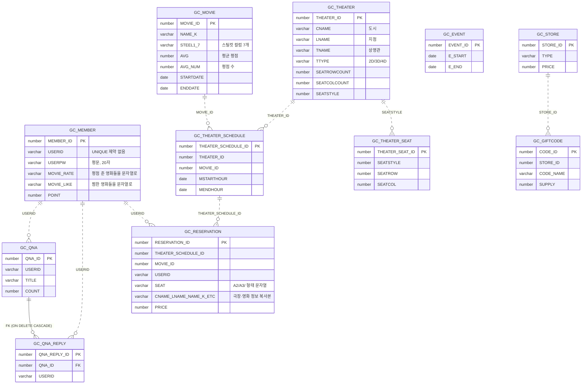
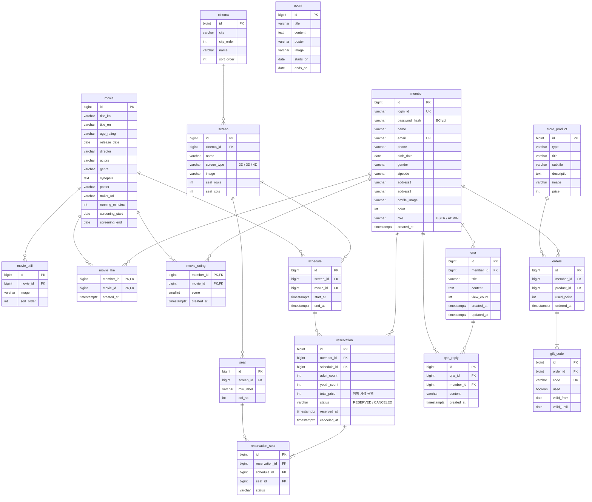

# ERD: 기존(Oracle) → 새 스키마(PostgreSQL)

- 기존: `legacy/sql/gaon-cinema-new.sql` 기준 테이블 11개. 실제 외래키는 `GC_QNA_REPLY → GC_QNA` **1개**뿐이고, 나머지 관계는 코드 안에서만 존재합니다.
- 새 스키마: **설계 초안**입니다. Phase 1부터 Flyway 마이그레이션으로 만들면서 확정하고, 바뀌면 이 문서도 같이 고칩니다.

## 1. 기존 스키마

점선(`..`)은 DB 제약 없이 코드에서만 쓰는 관계, 실선(`--`)은 실제 외래키입니다.



### 기존 스키마의 문제

| 문제 | 위치 | 영향 |
|---|---|---|
| 좌석을 문자열 하나로 저장 | `GC_RESERVATION.SEAT = 'A2/A3/'` | DB가 중복 예매를 막을 수 없음. 좌석 단위 조회·취소가 어려움 |
| 평점·찜을 문자열 컬럼에 누적 | `GC_MEMBER.MOVIE_RATE`, `MOVIE_LIKE` (300자) | 개수 제한, 검색·집계 불가, 동시 수정 시 유실 |
| 비밀번호 평문 저장 | `GC_MEMBER.USERPW VARCHAR2(20)` | 유출 시 그대로 노출. 해시를 넣기엔 길이 부족 |
| 아이디에 UNIQUE 없음 | `GC_MEMBER.USERID` | 중복 가입을 코드(`search.do`)로만 막음 |
| 외래키 부재 | 거의 모든 관계 | 없는 영화·상영관을 참조하는 데이터가 생길 수 있음 |
| 정보 복사 | `GC_RESERVATION`의 극장·영화 컬럼 10여 개 | 원본 정보가 바뀌면 불일치 |
| 반복 컬럼 | `GC_MOVIE.STEEL1`~`STEEL7` | 스틸컷이 정확히 7장이어야 함 |
| 상영관 행이 지점 정보까지 포함 | `GC_THEATER`의 `CNAME`, `LNAME` | 지점 정보가 상영관마다 중복 |
| 기프트코드 소유자 없음 | `GC_GIFTCODE`에 회원 컬럼 없음 | 누가 산 코드인지 DB로 알 수 없음 (메일로만 전달) |

## 2. 새 스키마 (초안)



### 핵심 제약

```sql
-- 같은 상영의 같은 좌석은 "예약 상태"인 행이 하나만 존재 (취소된 좌석은 다시 예매 가능)
CREATE UNIQUE INDEX uk_reservation_seat_active
    ON reservation_seat (schedule_id, seat_id)
    WHERE status = 'RESERVED';

-- 좌석 좌표 중복 방지
ALTER TABLE seat ADD CONSTRAINT uk_seat_position UNIQUE (screen_id, row_label, col_no);
```

- 평균 평점은 `movie_rating`에서 계산합니다. 조회가 느려지면 그때 `movie`에 집계 컬럼을 추가합니다.
- 테이블 이름 `orders`: `order`가 SQL 예약어라서 복수형을 씁니다.

### 기존 → 새 테이블 대응

| 기존 | 새 테이블 | 메모 |
|---|---|---|
| `GC_MEMBER` | `member`, `movie_like`, `movie_rating` | 평점·찜 문자열을 연결 테이블로 분리 |
| `GC_MOVIE` | `movie`, `movie_still` | `STEEL1~7` → 행으로. `AVG`, `AVG_NUM`은 계산값으로 |
| `GC_THEATER` | `cinema`, `screen` | 도시·지점과 상영관 분리 |
| `GC_THEATER_SEAT` | `seat` | 좌석 스타일 공유 대신 상영관별 좌석 |
| `GC_THEATER_SCHEDULE` | `schedule` | |
| `GC_RESERVATION` | `reservation`, `reservation_seat` | 좌석 문자열 분리, 복사 컬럼 제거 |
| `GC_QNA`, `GC_QNA_REPLY` | `qna`, `qna_reply` | 작성자를 `member_id` FK로 |
| `GC_EVENT` | `event` | |
| `GC_STORE` | `store_product` | |
| `GC_GIFTCODE` | `orders`, `gift_code` | 구매 기록을 새로 남기고 코드에 소유자 연결 |

## 확인이 필요한 것

- [ ] `GC_THEATER_SEAT.SEATSTYLE`이 좌석 배치(통로·빈칸)를 어떻게 표현하는지: 관리자 상영관 등록(`adminTheaterInsert.do`의 `listSeat`)과 좌석 화면(`step2.js`)을 같이 보고 `seat` 설계를 확정
- [ ] `GC_GIFTCODE.SUPPLY`의 의미 (수량인지, 사용 여부인지)
- [ ] 청소년·성인 가격 규칙 (현재 화면 JS에 하드코딩되어 있는지)
- [ ] 샘플 데이터 일부 INSERT의 값 개수가 테이블 정의와 맞지 않음: 이관 스크립트 작성 시 확인
